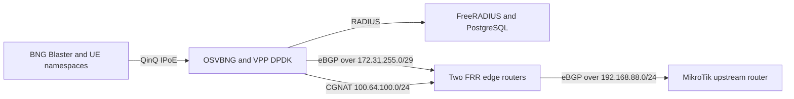

# Cloud-Native vBNG Edge Lab

This repository deploys a compact broadband edge on Kubernetes. OSVBNG and
VPP terminate subscriber sessions on DPDK interfaces, FreeRADIUS provides AAA,
and two FRR pods connect the CGNAT pool to an upstream router. An optional CPE
lab creates 20 IPoE subscribers with a Linux network namespace per session.

The design demonstrates a broader edge-computing direction: modern NICs,
userspace packet processing, SR-IOV/VFIO and Kubernetes CPU and hugepage
controls can consolidate packet-processing functions on the same cluster. A
small edge site can host the vBNG and routing functions without dedicating a
separate appliance to each role. Production sizing still depends on traffic,
features, NIC capabilities and failure-domain requirements.

## Architecture



Kubernetes schedules the control plane and supporting services. The SR-IOV
device plugin injects two `vfio-pci` virtio NICs into each BNG pod under the
resource name `qemu-virtio-dpdk.dev/osvbng_vfio`.

## Address plan

| Purpose | Addresses |
| --- | --- |
| BNG core transit | `172.31.255.2/29`, `172.31.255.3/29` |
| FRR core transit | `172.31.255.4/29`, `172.31.255.5/29` |
| FRR upstream | `192.168.88.12/24`, `192.168.88.13/24` |
| Upstream router | `192.168.88.1/24` |
| Subscriber pool | `10.255.0.0/24` |
| CGNAT pool | `100.64.100.0/24` |

The lab checked `.12` through `.15` with ICMP and ARP before selecting `.12`
and `.13`. Repeat the check in your own network before installation.

## Repository layout

- `charts/bng`: OSVBNG StatefulSet, VPP/DPDK, optional FreeRADIUS and PostgreSQL
- `charts/frr-isp`: two FRR routers with BGP on the BNG and upstream sides
- `charts/cpe-lab`: BNG Blaster, per-session network namespaces and optional GenieACS
- `scripts/deploy.sh`: repeatable installation sequence
- `scripts/validate.sh`: deployment and subscriber traffic checks

## Prerequisites

- Kubernetes 1.30 or later
- Multus and the host-device CNI
- Hugepages and two VFIO-bound virtio NICs per BNG worker
- The SR-IOV device plugin configuration in `charts/bng/sriov-device-plugin`
- Worker labels: `osvbng.infinitydon.com/bng-frr-ha=true`
- A consistent macvlan parent name on both edge workers
- MikroTik RouterOS 7 with the BGP configuration in `charts/frr-isp/MIKROTIK.md`

## Installation

```bash
export KUBECONFIG=/path/to/kubeconfig
export NAMESPACE=osvbng-edge

kubectl create namespace "$NAMESPACE" --dry-run=client -o yaml | kubectl apply -f -

helm upgrade --install osvbng charts/bng \
  --namespace "$NAMESPACE" \
  --values charts/frr-isp/bng-values.yaml \
  --wait --timeout 15m

helm upgrade --install osvbng-frr charts/frr-isp \
  --namespace "$NAMESPACE" \
  --wait --timeout 10m

helm upgrade --install osvbng-cpe-lab charts/cpe-lab \
  --namespace "$NAMESPACE" \
  --set genieacs.enabled=false \
  --wait --timeout 10m
```

The BNG chart defaults to two HA members. HA keeps the lab service available,
but the demonstration can focus on a single active BNG and the subscriber data
path. See `charts/bng/README.md` for standalone mode.

## Validation

```bash
NAMESPACE=osvbng-edge ./scripts/validate.sh
```

The validation checks pod readiness, HA state, BGP neighbors, active subscriber
count, CGNAT allocation and ping through all active UE namespaces.

The latest static and live-cluster results are recorded in [TESTING.md](TESTING.md).

## Presentation

The accompanying 10-minute deck is available at
`presentation/cloud-native-vbng-edge.pptx`. It includes speaker notes and
covers the subscriber path, Kubernetes architecture, NIC-assisted edge
consolidation, and the validated lab results.

## Presentation demo

For a short live demonstration:

1. Show the two BNG pods and their VFIO resources.
2. Show 20 established IPoE sessions.
3. Run a ping from one UE namespace.
4. Show the CGNAT mapping for that UE.
5. Show the CGNAT route on an FRR pod.

## License

The charts retain the licensing of their upstream OSVBNG components. See
individual file headers and upstream projects for details.
